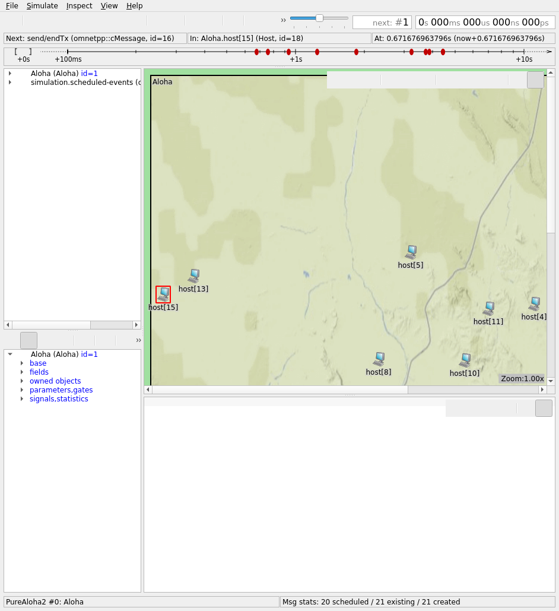
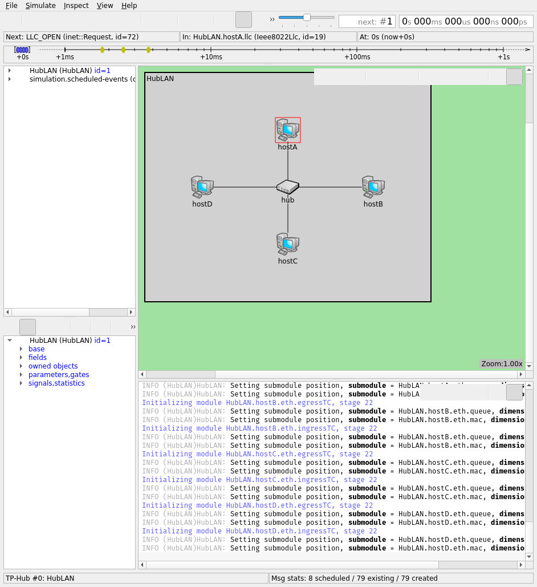
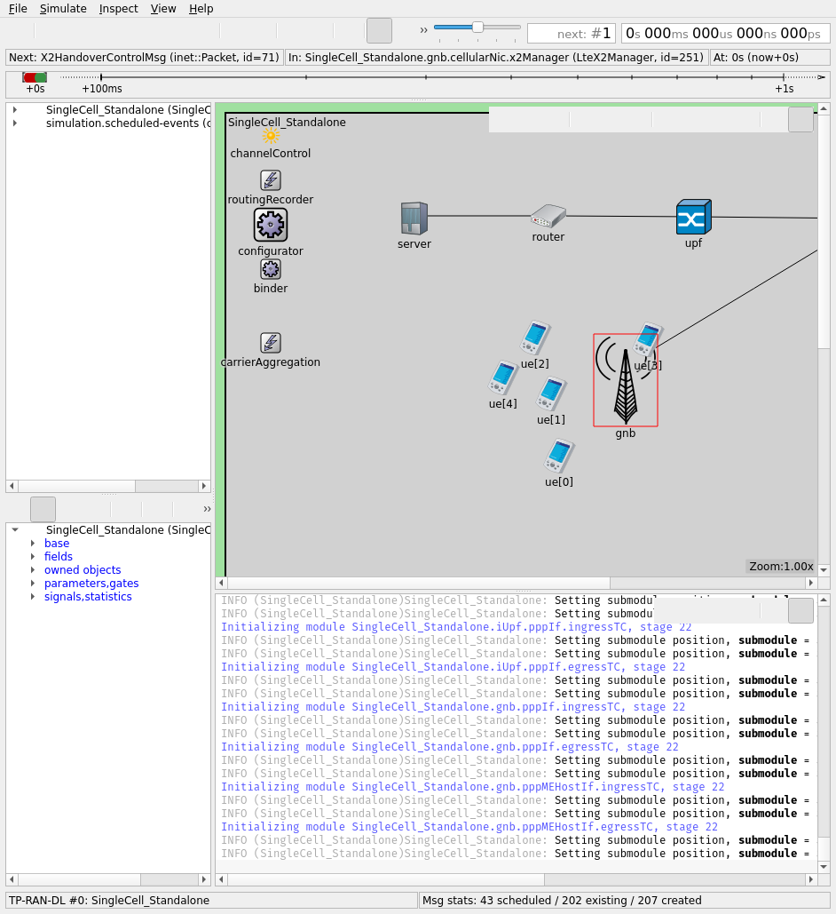

# 5G Radio Access Network Simulation — OMNeT++ / INET / Simu5G

A hands-on project for the Broadband Networks course. The idea was to learn how network
simulation actually works and to model a simplified 5G radio access network, moving step by step
from a 1970s shared-channel protocol all the way up to a working 5G cell.

Everything runs on three open-source tools that sit on top of each other:

- **OMNeT++ 6.1** — the discrete-event simulation engine and graphical interface.
- **INET 4.5** — a library of ready-made network models (Ethernet, IP, UDP, hosts, routers…).
- **Simu5G 1.3** — the 5G New Radio layer (base stations, terminals, radio channel, scheduler),
  built on top of INET.

The project is made of three experiments of growing complexity.

---

## 1. ALOHA — sharing one radio channel (OMNeT++)

ALOHA is the oldest way to share a channel: every station just transmits whenever it has
something to send. If two transmit at the same time, their signals collide and both are lost.
Running it under light, optimal and heavy traffic shows the classic trade-off.



The best case reached **17.3 % channel use**, right at the theoretical pure-ALOHA limit of ~18 %.
Pushing more traffic in only makes collisions waste the channel; too little traffic leaves it idle.

## 2. Wired Ethernet — hub vs switch (INET)

The wired cousin of ALOHA. A hub shares one wire between every device, so they collide; a switch
gives each device its own line, so collisions disappear. I ran the same heavy load on both and
also built a custom six-host topology (`tp_bignet.ned`).



| Scenario | Collisions | Channel time lost |
|---|---|---|
| Hub, 4 hosts | 172,647 | 23.9 % |
| Switch, 4 hosts | **0** | 0 % |
| Hub, 6 hosts (custom) | 500,245 | 45.4 % |

## 3. Simplified 5G RAN (Simu5G)

A small 5G Standalone cell: one base station (gNB) serving five moving phones (UEs). A server on
the Internet sends each phone a steady downlink stream, and I measured the metrics a real operator
cares about — throughput, delay, loss and radio quality.



Every phone received its full **~0.8 Mb/s with zero loss**, an end-to-end delay of **4–5 ms**, and
a near-perfect radio signal (CQI around 15/15). The base station carried about 4.1 Mb/s in total.

---

## Repository layout

```
config/       the custom scenario files I wrote
  tp_ran.ini      Task 3 — 5G cell with 5 UEs and downlink traffic
  tp_lan.ini      Task 2 — hub vs switch at the same load
  tp_bignet.ned   Task 2 — custom six-host hub topology
scripts/      one-command launchers for the GUI
  demo.sh         interactive menu to pick any scenario
  run_aloha_gui.sh / run_ethernet_gui.sh / run_5g_gui.sh
docs/         the written work
  5G_OMNeT_Simu5G_explained.pdf    full step-by-step walkthrough
  5G_Simulation_Presentation.pdf   the slides
screenshots/  the figures used above
```

## How to run it yourself

**Prerequisites.** Install the three tools into `~/omnetpp-ws` (the scripts expect that path):

- OMNeT++ 6.1, built from source.
- INET 4.5 and Simu5G 1.3, built against it.

**Place the scenario files** next to the examples they belong to:

- `config/tp_ran.ini` → `~/omnetpp-ws/Simu5G-1.3.0/simulations/NR/standalone/`
- `config/tp_lan.ini` and `config/tp_bignet.ned` → `~/omnetpp-ws/inet4.5/examples/ethernet/lans/`

**Then launch the interactive menu** and pick a scenario:

```bash
bash scripts/demo.sh
```

Once the OMNeT++ window opens, press **Run** to watch it, or **Fast / Express** to reach the end.
Each launcher also works on its own, for example:

```bash
bash scripts/run_5g_gui.sh          # 5G cell, 1 gNB + 5 UEs
bash scripts/run_ethernet_gui.sh TP-Switch   # Ethernet with a switch
```

## Documentation

- **`docs/5G_OMNeT_Simu5G_explained.pdf`** — a from-zero walkthrough that explains what each tool
  is, how a simulator works, how the `.ned` and `.ini` files are written line by line, and every
  result.
- **`docs/5G_Simulation_Presentation.pdf`** — a short slide deck summarising the project.
